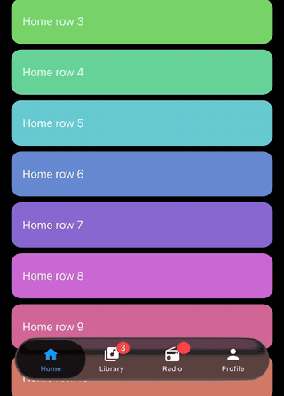
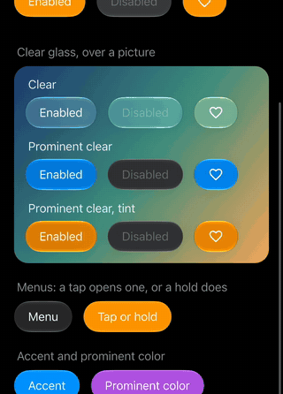
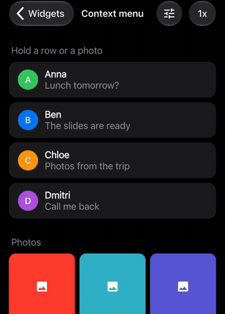
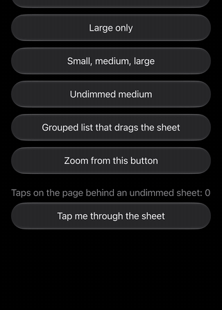

# morph

morph gives Flutter apps the controls of iOS 27 Liquid Glass: a tab bar
with its lens, glass buttons, menus that grow out of their button, context
menus, sheets, alerts, navigation bars, search, a date picker, lists, and
more.

Each spring, delay, and threshold comes from a measurement on an iPhone,
and tests replay recordings of the native controls against them. Every
control draws liquid glass or a flat look. Your app or your user picks
which.

<table>
  <tr>
    <td align="center"><br>Tab bar lens</td>
    <td align="center"><br>Menu from a glass button</td>
  </tr>
  <tr>
    <td align="center"><br>Context menu</td>
    <td align="center"><br>Sheet zoomed from its button</td>
  </tr>
</table>

The clips are filmed on an iPhone 16 Pro running the example gallery in
release mode.

> morph is built for my own apps, and its API follows what they need. It
> is not on pub.dev. Each version is a git tag that follows semver, so pin
> a tag.

## Try the gallery first

The example app has one page per control. It also has a slow-motion
switch and a glass page that changes the tier, the appearance, and the
text direction for the whole app. You can open the gallery in two ways:

- In the browser at <https://tembeon.github.io/morph/>. The web build
  draws flat glass. Liquid glass needs a native build.
- On your machine, from the `example` folder:

  ```bash
  flutter run
  ```

The API docs are at <https://tembeon.github.io/morph/docs/>.

## Add morph to your app

morph needs Flutter 3.47 or newer. Add it as a git dependency pinned to a
tag:

```yaml
dependencies:
  morph:
    git:
      url: https://github.com/Tembeon/morph.git
      ref: v0.8.0
```

One import covers the whole library:

```dart
import 'package:morph/morph.dart';
```

Import `package:morph/glass_painter.dart` only if your app paints its own
glass.

## Set up the theme and the shaders

Put a `MorphTheme` above your navigator:

```dart
void main() {
  runApp(
    WidgetsApp(
      color: const Color(0xFF007AFF),
      builder: (context, child) => MorphTheme(
        data: const MorphThemeData(glass: MorphGlassRenderer.adaptive()),
        child: child!,
      ),
      home: const HomePage(),
    ),
  );
}
```

`MorphThemeData` holds the brightness, the tint, the haptics, the glass,
and the per-control `appearances`. A null brightness follows the platform.
Menus, sheets, and alerts take the theme of the widget they open from.

On a `MaterialApp`, put the theme in `MaterialApp.builder` and pass it
`Theme.of(context).brightness`. morph itself does not depend on Material.

Liquid glass runs on Impeller with Flutter GPU. To turn on Flutter GPU,
add one entry per platform:

- On iOS and macOS, set `FLTEnableFlutterGPU` to `true` in `Info.plist`.
- On Android, add this entry inside `<application>` in
  `AndroidManifest.xml`:
  `<meta-data android:name="io.flutter.embedding.android.EnableFlutterGPU" android:value="true" />`.

The package's build hook compiles the shaders. The first `MorphTheme`
loads them and holds your app's first frame until they are ready, so the
first frame already shows liquid glass. There is nothing else to set
up.

## Choose liquid or flat glass

`MorphThemeData.glass` decides which glass the controls under the theme
draw:

- `MorphGlassRenderer.adaptive()` picks once per session from the GPU. It
  draws liquid glass on a capable GPU. It draws flat glass on the OpenGL
  ES fallback, on Skia, and on Apple GPUs older than the A13.
- `MorphGlassRenderer.tier(MorphGlassTier.flat)` or
  `MorphGlassRenderer.tier(MorphGlassTier.liquid)` fixes the tier, for
  example from a user setting.

If liquid glass cannot load, the controls draw flat glass. That happens on
the web, in a build without Flutter GPU, and after a shader error.
`MorphTheme.liquidGlassUnavailableReason` says why.

Both tiers have the same shapes, motion, and fusion. Only the shading
differs.

## Use the controls

To show a tab bar with a badge over a page that scrolls under its glass,
put a `MorphTabBar` at the bottom of a `Stack`:

```dart
Stack(
  children: [
    Positioned.fill(child: pages[tab]),
    Align(
      alignment: Alignment.bottomCenter,
      child: MorphTabBar(
        items: const [
          MorphTabItem(icon: IconData(0xe318), label: 'Home'),
          MorphTabItem(
            icon: IconData(0xe567),
            label: 'Inbox',
            badge: MorphBadge.count(3),
          ),
        ],
        selected: tab,
        onChanged: (int index) => setState(() => tab = index),
      ),
    ),
  ],
);
```

To open a menu from any widget on a tap, wrap the widget in a
`MorphMenuSource`. It works like `showsMenuAsPrimaryAction` in UIKit. A
`MorphGlassButton` takes the same `menu:` argument.

```dart
MorphMenuSource(
  menu: [
    MorphMenuItem(title: 'Copy', onSelected: copy),
    MorphMenuItem(title: 'Delete', destructive: true, onSelected: delete),
  ],
  child: const Text('Options'),
);
```

To open a context menu on a long press, wrap the widget in a
`MorphContextMenuRegion`. It works like `UIContextMenuInteraction`.

```dart
MorphContextMenuRegion(
  menu: [MorphMenuItem(title: 'Reply', onSelected: reply)],
  child: MessageRow(message),
);
```

To grow a sheet or a page out of the widget that opened it, name that
widget with a `MorphSourceLink`:

```dart
final link = MorphSourceLink();

MorphSource(
  link: link,
  shape: const RoundedRectangleBorder(
    borderRadius: BorderRadius.all(Radius.circular(16)),
  ),
  child: AlbumCard(album),
);

showMorphSheet<void>(
  context,
  from: link,
  detents: const [MorphSheetDetent.medium, MorphSheetDetent.large],
  builder: (context) => AlbumDetails(album),
);

Navigator.of(context).push(
  MorphNavigationRoute<void>(from: link, builder: (_) => AlbumPage(album)),
);
```

`showMorphSheet`, `showMorphAlert`, and `showMorphActionSheet` return when
the presentation is popped, like `Navigator.push`. Back, the barrier, and
Escape go through `PopScope`. If the source leaves the tree, the
presentation fades out instead of landing on it.

## Group neighbouring glass to keep it fast

Each separate liquid glass layer reads and filters what lies under it. On
a Pixel 6a, each layer costs about 0.3 to 0.75 ms of raster time per
frame, whatever its size. Apple gives the same advice for Liquid Glass:
group neighbouring glass. morph gives you three ways to do that:

- Wrap a row or a cluster of glass buttons in a `MorphGlassContainer`.
  Their resting glass is then shaded as one layer. Four resting buttons
  over a scrolling page took 18 percent less raster time on a Pixel 6a.
  Everything inside the container draws on top of its glass, so keep what
  the glass should show through below the container.
- Pass `solidBackdrop: color` to a `MorphGlassContainer` that sits on one
  opaque color, such as a card. Its glass is then painted over that color
  and reads no backdrop at all.
- Leave `MorphListSection`, a resting `MorphSearchToolbar`, the
  navigation bar, and the tab bar as they are. They group their own
  glass.

Resting glass in one `BackdropGroup` shares one copy of the screen. A card
of glass buttons drawn over other glass needs its own `BackdropGroup` to
show that glass through it.

## Give coding agents the API

This repository is also a Claude Code plugin. Its `use-morph` skill teaches
agents the current API from a reference that is generated from the
reviewed public API. To install the plugin, run these commands in Claude
Code:

```
/plugin marketplace add Tembeon/morph
/plugin install morph@morph
```

## Work on morph

`CLAUDE.md` and `docs/` describe how morph is built and tested: the
engine, the widget pattern, the glass renderer, performance, and the test
setup. The measurements of the native controls are in
`tool/ios_reference/spec/`.

## License

morph is under the [MIT license](LICENSE). The vendored glass renderer is
the exception. It is derived from
[liquid_glass_renderer](https://github.com/whynotmake-it/flutter_liquid_glass)
by Tim Lehmann for whynotmake.it and is under
[Apache-2.0](lib/src/glass/renderer/LICENSE). Its
[NOTICE](lib/src/glass/renderer/NOTICE) and
[VENDORED](lib/src/glass/renderer/VENDORED) files record the attribution
and the local changes. The adapted shaders keep Flutter's BSD notice and
Inigo Quilez's MIT notice.
