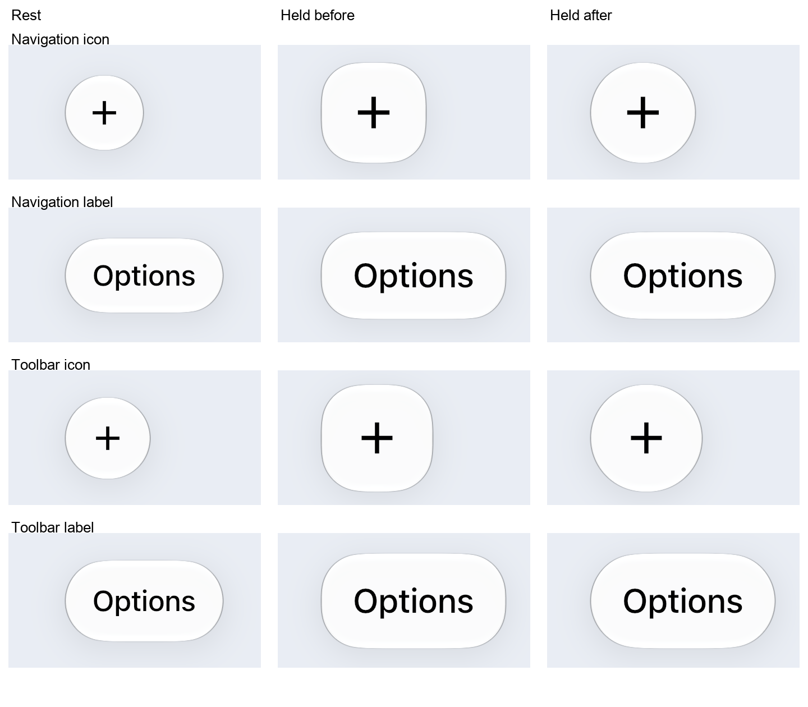

# Bar button hold silhouette

The gallery's navigation and toolbar buttons became rounded rectangles
when held. The same standalone glass buttons kept their original outlines.

## Reproduction and cause

`example/lib/perf/button_shape_capture.dart` renders two standalone glass
buttons and four `MorphBarItems` rows: an icon and a label with navigation
metrics, then an icon and a label with toolbar metrics. A synthetic pointer
holds each control for two seconds on the real liquid renderer. The device
oracle saves resting, lifting, held and returned screenshots under each of
three modes: normal `changes`, forced matte, and forced analytic geometry.

Captured on iPhone 16 Pro, iOS 27.0.1, 402 x 874 pt at 3x. Before and after
runs both completed all three modes. The problem is visible in all of them,
so it originates above the renderer and does not depend on analytic/matte
switching.

In `MorphBarItems._sync`, the press scaled the capsule's rectangle but
constructed its corner radius from the original rectangle. A 44 pt tall
navigation capsule kept a 22 pt corner while its height grew. Its radius
became smaller relative to the height, exposing straight sides. Toolbar
capsules had the same error with their original 24 pt radius. Standalone
`MorphGlassButton` transforms its whole surface, so its corners grew with it.

The bar now constructs the lifted outline through the same
`morphCapsuleShape` helper as the standalone button, using the current
deformed size. This fixes navigation bars and toolbars and supplies the
correct outline to every renderer. The shared bar layer remains necessary
for capsule fusion and item transitions; it does not require separate
corner geometry.



The normal-mode resting screenshots before and after are pixel-identical.
The forced-mode resting comparisons have mean absolute channel differences
of 0.00213/255 (matte) and 0.00234/255 (analytic); no tolerance was changed.
`capture-manifest.json` records both complete runs and the hashes of their
24 full-size device screenshots. `navigation-hold.png` is a compact crop
of the same before/after navigation icon shots.

## Regression coverage

Four tests in `test/bar_press_shape_test.dart` cover navigation and toolbar,
each with icon and text capsules. They check fully rounded ends on every
sample during hold, drag, release and spring recoil. All four failed on the
old radius calculation. Return-to-rest checks use the existing
`MorphRest.length` bound; the per-frame radius relationship is checked to
1e-9 pt. Existing replay, pixel and count limits remain unchanged.

The full root suite passes: 2356 tests, two existing intentional skips.
Static analysis reports no issues.

## Repeating the physical capture

Hold `/tmp/morph-native/device.lock`, then build the entrypoint:

```sh
cd example
flutter build ios --release -t lib/perf/button_shape_capture.dart
```

Install and launch the signed `Runner.app` as `dev.tembeon.morphExample`.
After about 30 seconds copy `tmp/button-shapes` from its app data container.
Require `result.json` to report `complete: true`. Restore a normal
`flutter build ios --release -t lib/main.dart` gallery after the capture.
